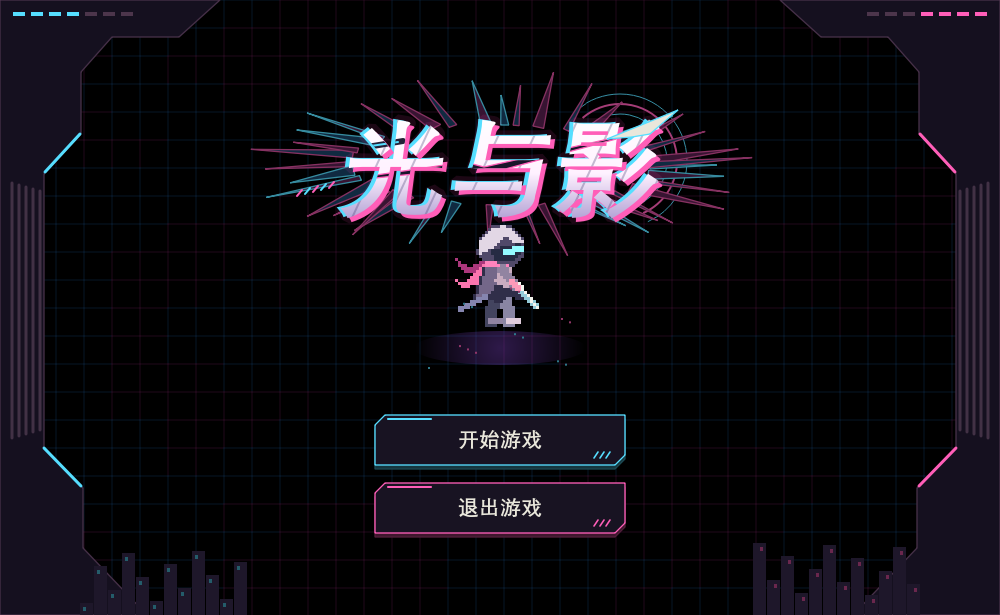

# 光与影

高级语言编程实训课程大作业 Demo，使用 C++17 与 Qt Widgets 实现。

黑暗中的探索与战斗原型。玩家通过声波扫描地形，冲刺留下裂痕并收刀攻击，调整光源完成解谜、抵挡攻击。包含新手训练与连续五层的第一关，末层为首领战。

## 直接运行

下载 [Windows 完整试玩包](dist/Light-and-Shadow-Windows.zip)，解压全部文件，运行其中的 PenumbraTraining.exe。需要 Windows 64 位，Qt 运行库已随包提供。

选关页有「新手训练」和「第一关 · 失谐回廊」两个入口。第一关从第一层开始连续推进。

## 操作

| 操作 | 按键 |
| --- | --- |
| 移动 | WASD / 方向键 |
| 冲刺并留下裂痕 | 鼠标左键，朝指针方向 |
| 收刀引爆裂痕 | 鼠标右键 |
| 声波扫描 | 空格 |
| 调整光源 | 鼠标按住光源拖动 |
| 首领战瞄准灯光 | 按住光源向场内拖动，松手保留方向 |
| 重试当前区域 | R |
| 返回选关 | Esc |

共鸣点需要先由声波显形，再用裂痕收刀激活。小地图显示近期声波接触的墙面、光源与探测到的敌人，地形回声约 15 秒后淡出。

## 从源码编译

使用 Qt Creator 打开 src/PenumbraTraining.pro，选择 Qt 6 的 Desktop MinGW 64-bit 套件，构建并运行。当前验证环境为 Qt 6.5.3、MinGW 11.2 与 Windows 64 位。

也可以在配置好 Qt 和 MinGW 的命令行中构建：

    mkdir build
    cd build
    qmake ../src/PenumbraTraining.pro
    mingw32-make

源码使用 Qt Widgets 和 Windows winmm 音频。角色、地形、光源和战斗效果由 QPainter 绘制。

## 验证

程序提供离屏回归检查，覆盖菜单、新手训练、五层路线、声波与共鸣点、光影装置、敌人和首领战：

    PenumbraTraining.exe --verify screenshots

检查成功返回 0，并在指定目录生成画面截图。试玩版本的关卡平衡仍在迭代。

## 画面

## 第三方组件

试玩包包含动态链接的 Qt 6 和 MinGW 运行库。Qt 组件由 The Qt Company 及其贡献者提供，相关版权、许可和源码获取信息见 [Qt 官方许可说明](https://www.qt.io/licensing/open-source-lgpl-obligations)。
