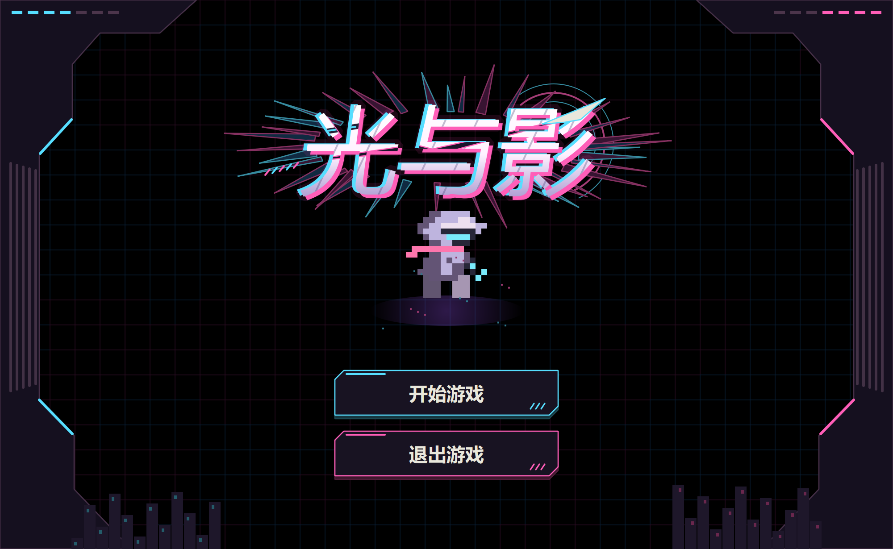
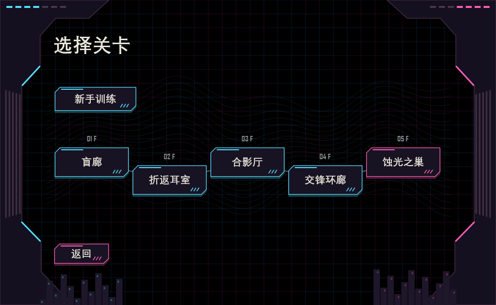
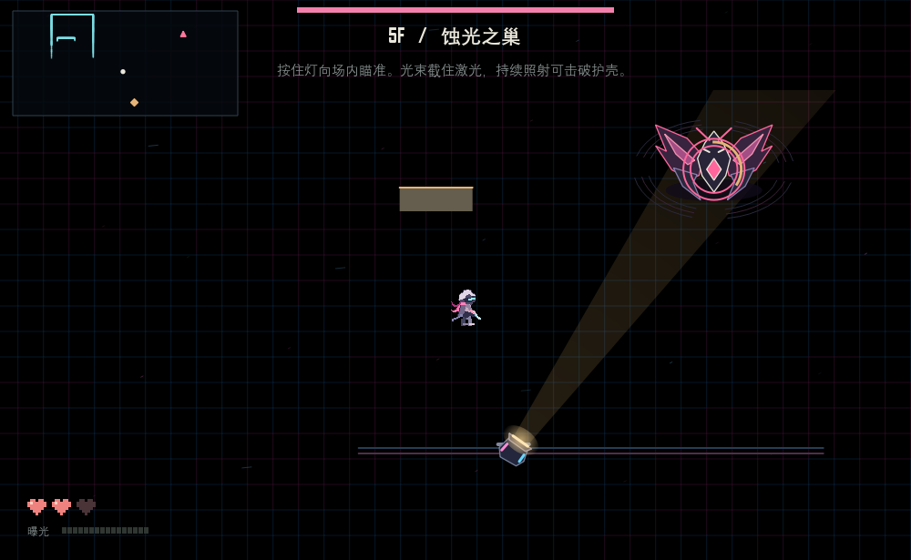

# 光与影 · PenumbraTraining

高级语言程序设计实训游戏 Demo，使用 C++17 与 Qt Widgets 实现。围绕移动、冲刺、斩击、回声与光影机关展开，包含教学流程、关卡选择和首领战。



## 构建与运行

建议使用 Qt 6.5.3、MinGW 64 位工具链与 Qt Creator。用 Qt Creator 打开 `PenumbraTraining.pro`，选择对应的桌面 Kit，构建后运行。项目使用 Qt Widgets、Qt Gui、Qt Core；Windows 下通过 `winmm` 播放程序生成的音效。

也可在已经配置 Qt 与 MinGW 环境变量的终端中构建：

```sh
qmake PenumbraTraining.pro
mingw32-make release
```

Windows 下生成的程序通常位于 `release/PenumbraTraining.exe`。如需分发可运行版本，应使用所选 Qt Kit 的 `windeployqt` 补齐运行依赖；本仓库保存源码与演示素材，不包含 Qt 运行库。

## 操作

使用 WASD 或方向键移动。鼠标左键向指针位置冲刺，右键斩击，空格触发回声。可交互的灯具支持鼠标左键拖动，具体机制以游戏内教学提示为准。

R 重置当前关卡；游戏中按 Esc 返回关卡选择，菜单中按 Esc 返回标题界面，在标题界面再次按 Esc 退出。

## 项目文件

`main.cpp` 包含窗口、游戏逻辑、输入处理、绘制和内置验证入口；`actors.inc` 与 `warden.inc` 是被主文件包含的实现片段。`PenumbraTraining.pro` 是 qmake 项目配置。

`screens/` 保存开发期间的演示截图与动画。`sprites.png` 和 `sprites.qrc` 保留素材及其资源描述；当前 `.pro` 未启用该资源文件。





## 内置验证入口

程序支持 `--verify <输出目录>`，用于运行代码中内置的验证流程并输出截图。例如，在 Qt 运行环境已配置的 Windows 终端中执行：

```sh
release\PenumbraTraining.exe --verify verify-output
```

返回码 0 表示内置检查通过，2 表示检查未通过。仓库中的演示截图不代表本次上传时重新完成了验证。
